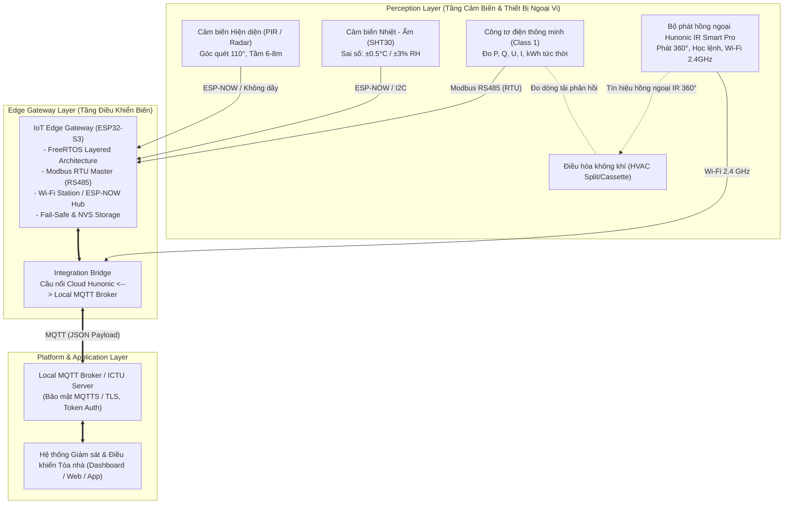

# ĐỀ TÀI ĐỒ ÁN TỐT NGHIỆP

> **Tên đề tài:** Thiết kế, tích hợp phần cứng IoT và Gateway điều khiển HVAC hai chiều cho tòa nhà thông minh tại ICTU  
> **Địa điểm thực hiện:** Trường Đại học Công nghệ Thông tin & Truyền thông - Đại học Thái Nguyên (ICTU)

---

## 1. Mục Tiêu Của Đồ Án

### 1.1. Về kiến thức & kỹ năng
* **Kiến trúc hệ thống IoT:** Nắm vững kiến trúc phần cứng hệ thống IoT phân lớp (Perception - Network/Edge Gateway - Application/Cloud) trong ngữ cảnh tòa nhà thông minh (Smart Building).
* **Giao thức truyền thông công nghiệp & IoT:** Làm chủ và triển khai tích hợp đa giao thức:
  * **Modbus RS485 (RTU):** Đọc dữ liệu đo lường công tơ điện công nghiệp.
  * **Wi-Fi 2.4 GHz & ESP-NOW:** Truyền nhận dữ liệu tốc độ cao, độ trễ thấp giữa các node cảm biến và trạm Gateway.
  * **MQTT & MQTTS:** Giao thức nhắn tin pub/sub tối ưu cho hạ tầng IoT/Cloud.
* **Cơ chế điều khiển & Tự động hóa:**
  * Làm chủ cơ chế **phản hồi trạng thái hai chiều (Two-Way Feedback)** giữa bộ điều khiển và thiết bị thực tế.
  * Thiết kế và làm chủ các kỹ thuật xử lý an toàn: **Fail-safe** (chống sự cố, tự phục hồi) và **Manual Override** (ưu tiên can thiệp thủ công) trong hệ thống tự động hóa.

### 1.2. Về sản phẩm
* **Hệ thống phần cứng:** Lắp đặt và tích hợp hoàn chỉnh mô hình phần cứng gồm cảm biến hiện diện, cảm biến nhiệt độ - độ ẩm, công tơ điện và bộ điều khiển hồng ngoại tại phòng thí điểm (pilot room) tại ICTU.
* **Phần mềm nhúng & Gateway:** Lập trình Edge Gateway thu thập dữ liệu đa giao thức, phân tích cục bộ và đóng gói truyền tải tin cậy qua MQTT Broker trung tâm.

---

## 2. Kiến Trúc Hệ Thống Tổng Thể

---

## 3. Khối Lượng Và Nội Dung Nhiệm Vụ Chi Tiết

### Giai đoạn 1: Khảo sát, lựa chọn và thiết kế sơ đồ nguyên lý phần cứng
1. **Khảo sát hệ thống HVAC thực tế:**
   * Khảo sát chủng loại máy điều hòa không khí tại các phòng học, phòng làm việc và phòng lab thực tế tại ICTU.
   * Xác định vị trí bố trí remote, góc quét hồng ngoại và không gian lắp đặt cảm biến để tối ưu hóa vùng phủ sóng.
2. **Lựa chọn & đấu nối thiết bị đo lường - cảm biến:**
   * **Cảm biến hiện diện (PIR / Occupancy Sensor):** Góc quét 110°, tầm quét 6–8 m, nhận biết chính xác trạng thái có người trong phòng.
   * **Cảm biến nhiệt độ - độ ẩm:** Độ chính xác cao (±0.5°C / ±3% RH), đo đạc điều kiện vi khí hậu phòng.
   * **Công tơ điện thông minh:** Cấp chính xác Class 1, hỗ trợ truyền thông Modbus RS485/Wi-Fi để giám sát công suất tức thời và điện năng tiêu thụ theo nhánh/phòng.
3. **Bộ điều khiển hồng ngoại thông minh:**
   * Tích hợp thiết bị **Hunonic IR Smart Pro** (nguồn DC 5V/1A, góc phát hồng ngoại 360°, kết nối Wi-Fi 2.4 GHz).
   * Hỗ trợ học lệnh từ remote gốc, cấu hình kịch bản nhiệt độ, giới hạn thời gian chạy và hỗ trợ phản hồi trạng thái hai chiều.
4. **Thiết kế sơ đồ nguyên lý & sơ đồ đi dây:**
   * Thiết kế sơ đồ nguyên lý cấp nguồn hệ thống (Power Supply Distribution).
   * Bản vẽ kết nối tín hiệu cảm biến, công tơ điện về Gateway và hạ tầng mạng mạng cục bộ.

---

### Giai đoạn 2: Lập trình Gateway & Tích hợp truyền thông đa giao thức
1. **Cấu hình Gateway / Edge Gateway công nghiệp:**
   * Xây dựng firmware đa nhiệm trên nền ESP-IDF v5.3+ và FreeRTOS.
   * Cấu hình giao tiếp **Modbus RS485** định kỳ (polling) đọc các thanh ghi công suất, điện áp, dòng điện từ công tơ điện.
   * Cấu hình giao tiếp **Wi-Fi / ESP-NOW** thu thập gói tin từ các node cảm biến môi trường và bộ phát IR.
   * Đảm bảo năng lực phần cứng kết nối đồng thời và quản lý tối thiểu **30–50 thiết bị**.
2. **Xây dựng Integration Bridge (Cầu nối tích hợp):**
   * Thiết kế và lập trình mô-đun Integration Bridge liên kết dữ liệu giữa Cloud MQTT của nhà sản xuất (Hunonic) với Local MQTT Broker của ICTU.
   * Chuẩn hóa cấu trúc Topic MQTT phân cấp và định dạng bản tin (Payload dạng JSON) kèm `timestamp`, `deviceID`, `roomID`, `status` và các thông số đo lường.

---

### Giai đoạn 3: Lập trình cơ chế an toàn (Fail-Safe, Manual Override & Bảo mật)
1. **Xây dựng cơ chế Fail-Safe & Mất kết nối:**
   * Tự động lưu giữ trạng thái và lệnh gần nhất vào bộ nhớ Flash không bay hơi (NVS Flash).
   * Xây dựng cơ chế tự động kết nối lại (Auto-reconnect mechanism) khi mất Wi-Fi hoặc gián đoạn MQTT Broker.
   * Đảm bảo việc mất kết nối trung tâm không gây ngưng trệ điều khiển cục bộ (Local Autonomous Control).
2. **Cơ chế Manual Override (Đón đầu điều khiển thủ công):**
   * Đảm bảo khi người dùng can thiệp bật/tắt bằng remote vật lý tại phòng, hệ thống vẫn cập nhật tức thời trạng thái thực tế về Gateway và Server thông qua cơ chế phản hồi hai chiều (kết hợp đo đạc dòng tải công tơ điện và cảm biến nhiệt).
3. **Cấu hình bảo mật phần cứng:**
   * Triển khai mã hóa dữ liệu đường truyền bằng TLS/SSL (MQTTS).
   * Cơ chế xác thực chuỗi thiết bị (Device Authentication) và quản lý Token / API Key an toàn.

---

### Giai đoạn 4: Thử nghiệm, tinh chỉnh và đánh giá chỉ tiêu kỹ thuật
1. **Lắp đặt thử nghiệm thực tế:**
   * Triển khai lắp đặt hoàn chỉnh mô hình tại 01 phòng thí điểm tại trường Đại học Công nghệ Thông tin & Truyền thông (ICTU).
2. **Đo đạc và đánh giá số liệu thực nghiệm:**
   * Đo độ trễ truyền nhận lệnh (End-to-End Latency).
   * Đánh giá tỷ lệ mất gói tin (Packet Loss Rate).
   * Đánh giá độ ổn định kết nối và hoạt động liên tục 24/7 trong môi trường vận hành thực tế.

---

## 4. Sản Phẩm Bàn Giao Và Chỉ Tiêu Kỹ Thuật

### 4.1. Sản phẩm phần cứng & phần mềm nhúng
* **Tủ/bảng phần cứng tích hợp hoàn chỉnh:**
  * 01 Trạm Edge Gateway trung tâm (ESP32-S3).
  * 01 Công tơ điện thông minh Modbus RS485.
  * 01 Node cảm biến hiện diện (ESP32-C3 PIR/Radar).
  * 01 Node cảm biến nhiệt độ - độ ẩm không dây (SHT30).
  * 01 Bộ điều khiển hồng ngoại thông minh Hunonic IR Smart Pro.
* **Mã nguồn phần mềm nhúng:**
  * Firmware Gateway điều phối trung tâm (ESP32-S3).
  * Firmware các node cảm biến thu thập dữ liệu (ESP32-C3).
  * Mã nguồn mô-đun Integration Bridge (kết nối Cloud Hunonic và Local Broker).

### 4.2. Hồ sơ kỹ thuật
* Bản vẽ sơ đồ nguyên lý đấu nối, sơ đồ kiến trúc phần cứng tổng thể.
* Tài liệu hướng dẫn lắp đặt, cấu hình, vận hành và quy trình xử lý sự cố hệ thống.
* Báo cáo kết quả thử nghiệm và đánh giá chỉ tiêu kỹ thuật thực tế tại phòng thí điểm ICTU.

### 4.3. Chỉ tiêu kỹ thuật tối thiểu cần đạt

| STT | Chỉ Tiêu Kỹ Thuật | Yêu Cầu Cần Đạt | Ghi Chú |
|:---:|:---|:---|:---|
| 1 | **Độ tin cậy kết nối** | $\ge \mathbf{98\%}$ | Vận hành liên tục 24/7 không treo/mất kết nối kéo dài |
| 2 | **Độ trễ điều khiển** | $< \mathbf{10\text{ giây}}$ | Từ lúc phát lệnh đến khi thiết bị thực thi và phản hồi trạng thái |
| 3 | **Đồng bộ trạng thái** | $\le \mathbf{1\text{ phút/lần}}$ | Cập nhật định kỳ trạng thái điều hòa và vi khí hậu phòng |
| 4 | **Khả năng quản lý thiết bị** | $\mathbf{30 \sim 50\text{ thiết bị}}$ | Gateway kết nối đồng thời và quản lý tin cậy |
| 5 | **Độ chính xác cảm biến** | $\pm 0.5^\circ\text{C}$ / $\pm 3\%\text{ RH}$ | Cảm biến môi trường nhiệt ẩm công nghiệp |
| 6 | **Độ chính xác đo điện** | **Class 1** | Chuẩn đo lường công tơ điện thông minh Modbus |
| 7 | **Góc phát điều khiển IR** | $\mathbf{360^\circ}$ | Phủ đều toàn phòng, không góc chết |

---

*Tài liệu được biên soạn và lưu trữ tại thư mục dự án:* [`/home/quanghaictu/DATN_NAM/Document/nhiem_vu_do_an.md`](file:///home/quanghaictu/DATN_NAM/Document/nhiem_vu_do_an.md)
